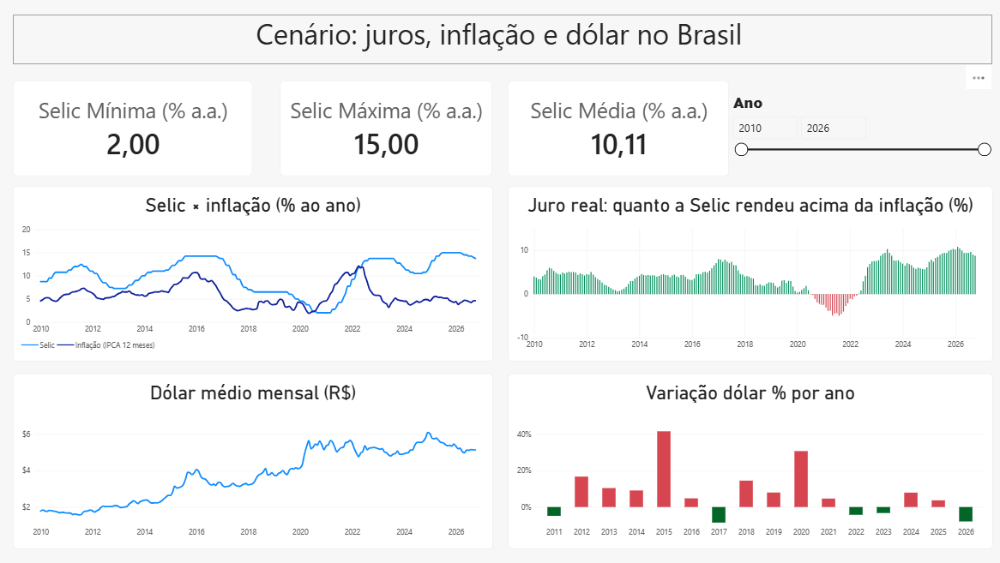
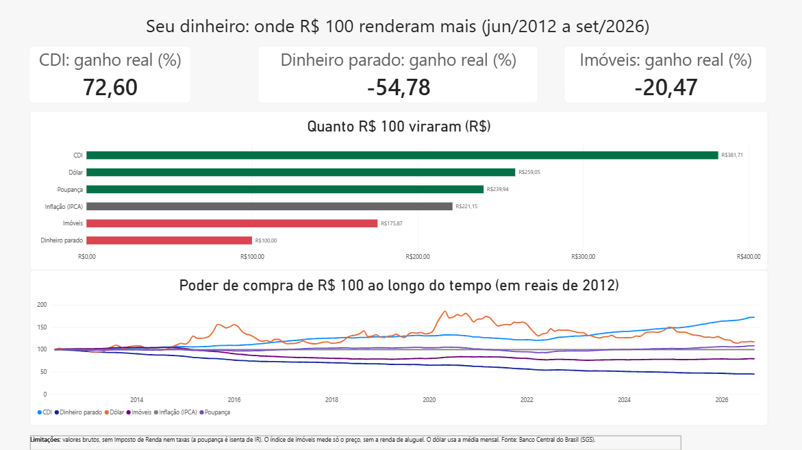

# Análise de Selic, Inflação e Câmbio no Brasil

Projeto de análise de dados com Python, SQL e Power BI usando dados públicos do Banco Central do Brasil.

## Objetivo

O projeto responde a duas perguntas, em duas partes:

1. **O cenário:** como juros, inflação e câmbio se comportaram no Brasil desde 2010 e como se
   relacionam entre si (períodos de juro real negativo, anos de maior volatilidade do dólar e o
   efeito da Selic sobre o câmbio).
2. **O impacto no bolso:** nesse cenário, onde R$ 100 aplicados em junho de 2012 renderam mais do
   que a inflação: CDI, poupança, dólar, imóveis ou dinheiro parado?

## Painel (Power BI)

**Página 1 – Cenário:** Selic × inflação, juro real, dólar mensal e variação anual do dólar.



**Página 2 – Seu dinheiro:** ranking dos investimentos e evolução do poder de compra de R$ 100.



O arquivo do painel está em `powerbi/painel_selic_inflacao.pbix` (abre no Power BI Desktop).

## Fontes de dados

Todas as séries vêm do [SGS – Sistema Gerenciador de Séries Temporais](https://www3.bcb.gov.br/sgspub/) do Banco Central, consultado pela API pública.

| Tabela               | Código SGS | Periodicidade | Descrição                                   |
|----------------------|-----------:|---------------|---------------------------------------------|
| `selic_meta`         | 432        | Diária        | Meta da taxa Selic (% a.a.)                 |
| `ipca_mensal`        | 433        | Mensal        | IPCA – variação mensal (%)                  |
| `ipca_12m`           | 13522      | Mensal        | IPCA – acumulado em 12 meses (%)            |
| `dolar_medio_mensal` | 3698       | Mensal        | Dólar comercial, média do mês (R$)          |
| `cdi_mensal`         | 4391       | Mensal        | CDI acumulado no mês (%)                    |
| `poupanca`           | 195        | Diária        | Rendimento da poupança, regra nova (desde maio de 2012) |
| `imoveis_ivgr`       | 21340      | Mensal        | Índice de valores de garantia de imóveis residenciais |

## Como rodar

```bash
python -m venv .venv
.venv\Scripts\activate            # Windows (no Linux/macOS: source .venv/bin/activate)
pip install -r requirements.txt

python src/coletar_dados.py       # baixa as séries da API -> data/raw/*.csv
python src/carregar_banco.py      # carrega os CSVs no SQLite -> data/macro.db
python src/exportar_powerbi.py    # gera as tabelas do painel -> data/processed/*.csv
```

As consultas da pasta `sql/` podem ser executadas em qualquer cliente SQLite (DB Browser for SQLite,
extensão SQLite do VS Code etc.) apontando para `data/macro.db`.

## Estrutura

```
src/            coleta (API do BCB), carga no SQLite e exportação para o Power BI;
                config.py lista as séries e os caminhos
sql/            consultas de análise, numeradas, com os resultados comentados
                (07 e 08 geram as tabelas do painel)
data/raw/       CSVs brutos baixados da API (versionados)
data/processed/ CSVs tratados que alimentam o Power BI (versionados)
data/macro.db   banco SQLite gerado pela carga (não versionado)
powerbi/        arquivo do painel (.pbix)
images/         prints do painel usados neste README
exploracao/     scripts de teste e rascunhos
```

## Principais conclusões

### Parte 1: o cenário

- **Selic:** a mínima histórica de 2% durou de 6 de agosto de 2020 a 17 de março de 2021 (224 dias); a máxima do
  período, 15%, durou de 19 de junho de 2025 a 18 de março de 2026 (273 dias).
- **Juro real negativo por 22 meses seguidos** entre 2020 e 2022: a Selic na mínima durante a pandemia
  coincidiu com a alta da inflação. Pelo CDI acumulado em 12 meses, o período foi de outubro de 2020 a julho de 2022.
- **Dólar:** 2015 teve a maior alta da média anual (+41,6% sobre 2014) e 2020 foi o ano mais instável
  (diferença de R$ 1,49 entre o maior e o menor mês). Em 2022 e 2023, com a Selic alta atraindo
  capital estrangeiro, a média anual do dólar caiu (-4,3% e -3,3%).
- **Extremos do dólar (média mensal):** mínimo de R$ 1,56 em julho de 2011 e máximo de R$ 6,10 em
  dezembro de 2024.

### Parte 2: onde R$ 100 renderam mais (junho de 2012 a setembro de 2026)

O período foi escolhido por ser o único em que todas as séries têm dados completos: a série da
poupança (regra nova) começa em maio de 2012 e o índice de imóveis vai até setembro de 2026.

| Posição | Investimento     | R$ 100 viraram | Ganho real (acima do IPCA) |
|--------:|------------------|---------------:|---------------------------:|
| 1º      | CDI              | R$ 381,71      | +72,60%                    |
| 2º      | Dólar            | R$ 259,05      | +17,14%                    |
| 3º      | Poupança         | R$ 239,94      | +8,50%                     |
| –       | Inflação (IPCA)  | R$ 221,15      | referência                 |
| 4º      | Imóveis          | R$ 175,87      | -20,47%                    |
| 5º      | Dinheiro parado  | R$ 100,00      | -54,78%                    |

- **CDI:** o único que ficou acima da inflação em todos os meses do período, com crescimento constante.
- **Dólar:** ganho real de 17%, mas com muita instabilidade. No pico, em maio de 2020, o poder de
  compra chegou a 186% do inicial; o resultado depende muito do momento da compra e da venda.
- **Poupança:** ganhou da inflação por pouco e passou 77 meses abaixo dela, entre o fim de 2012 e
  outubro de 2023 (o pior momento foi em abril de 2022, durante o juro real negativo).
- **Imóveis:** o preço ficou abaixo da inflação a partir de março de 2015 e não se recuperou mais.
- **Dinheiro parado:** perdeu mais da metade do poder de compra em 14 anos.

O ganho real é calculado pela divisão `(valor final / valor corrigido pelo IPCA - 1)`, e não pela
subtração, que superestimaria o resultado.

## Limitações

- Os valores são brutos, sem Imposto de Renda nem taxas (a poupança é isenta de IR; o CDI, não).
- O índice de imóveis (IVG-R) mede só o preço, sem a renda de aluguel, e é uma média nacional dos
  imóveis financiados: cidades e bairros variam muito.
- O dólar usa a média mensal, não a cotação de um dia específico.
- A Selic dos indicadores mensais é a do dia 1º de cada mês.
- É uma análise histórica: o passado não garante resultados futuros, e não é recomendação de investimento.
